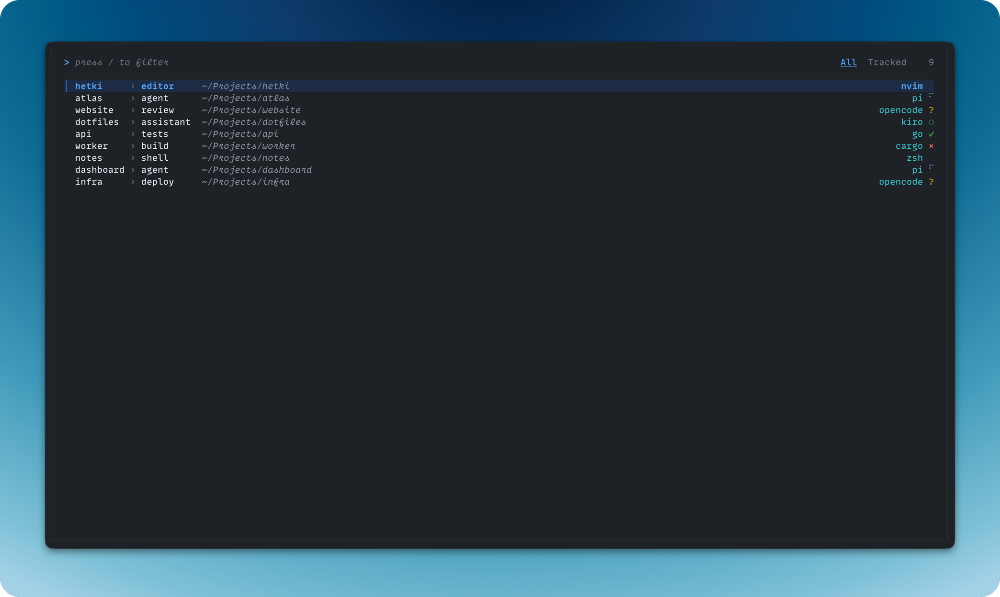

# Hetki

Navigate tmux sessions and save your setup to use again later.
A keyboard-first tool for Linux and macOS.

- Find sessions, windows, and panes in a searchable picker.
- Preview panes and see activity from supported apps.
- Save tmux sessions as YAML workspaces and start them again.



## Install

Install tmux first. On macOS, use Ventura 13 or later.

```bash
curl -fsSL https://raw.githubusercontent.com/MuhametSmaili/hetki/main/install.sh | bash
```

See [installation](docs/installation.md) for Homebrew, Go, mise, system requirements, and updates.

## First use

Run `hetki`, type part of a name, and press Enter to switch.
Press `Ctrl+K` for actions or `Ctrl+C` to quit.
Your sessions remain in tmux when you close the picker.

See [getting started](docs/getting-started.md) for views, pane previews, and your first workspace.

## Documentation

Read the [documentation](https://hetki.smaili.dev).

- [Workspaces](docs/workspaces.md): save and start tmux setups.
- [Application status](docs/status.md): activity indicators, profiles, and troubleshooting.
- [Configuration](docs/configuration.md): picker defaults, flags, and layout.
- [Key bindings](docs/key-bindings.md) and [theme](docs/theme.md): customize the picker.
- [User-defined actions](docs/actions.md): chain choices and run commands for panes and sessions.
- [Shell completion](docs/shell-completion.md): Bash and Zsh setup.

Workspaces save session structure, not running processes or terminal contents.

## License

[MIT](LICENSE)
